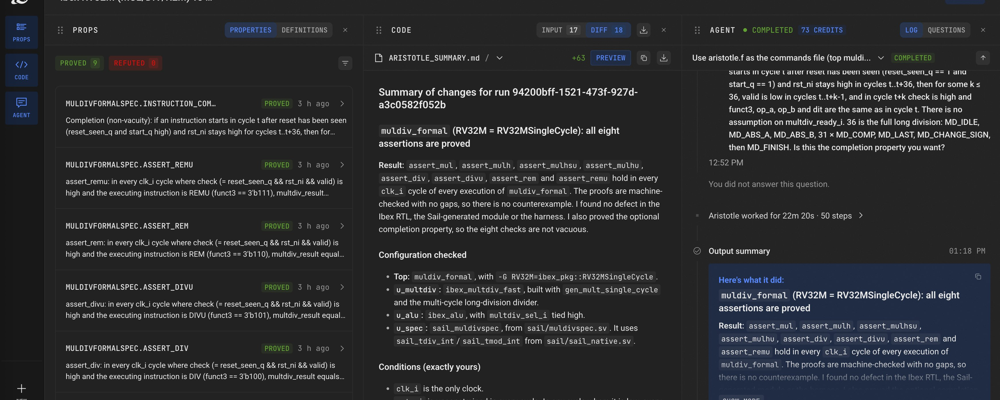
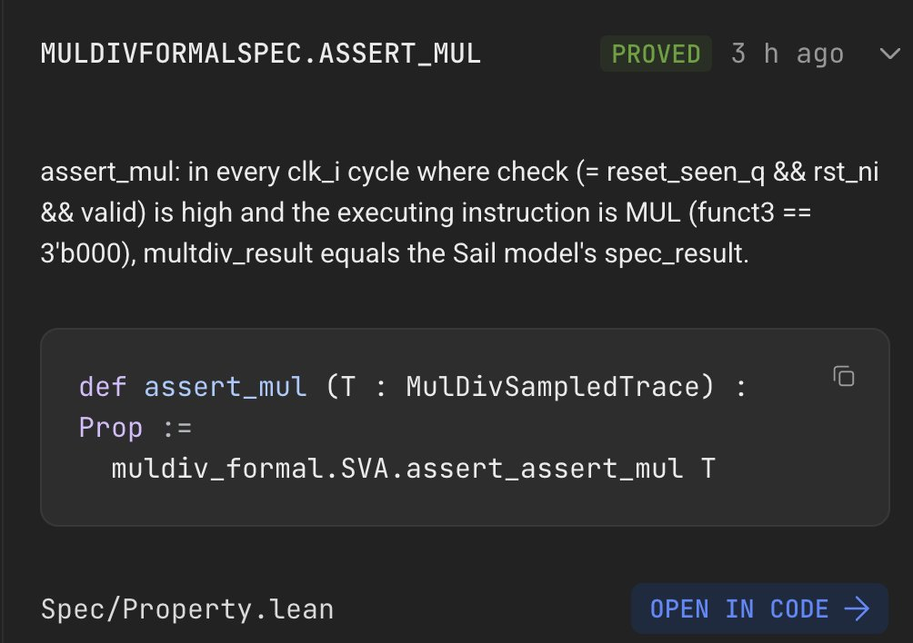
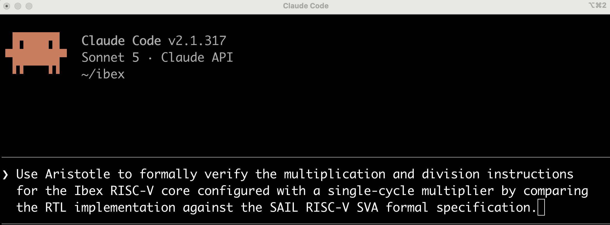
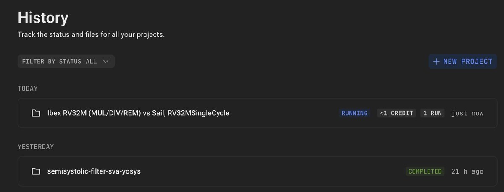
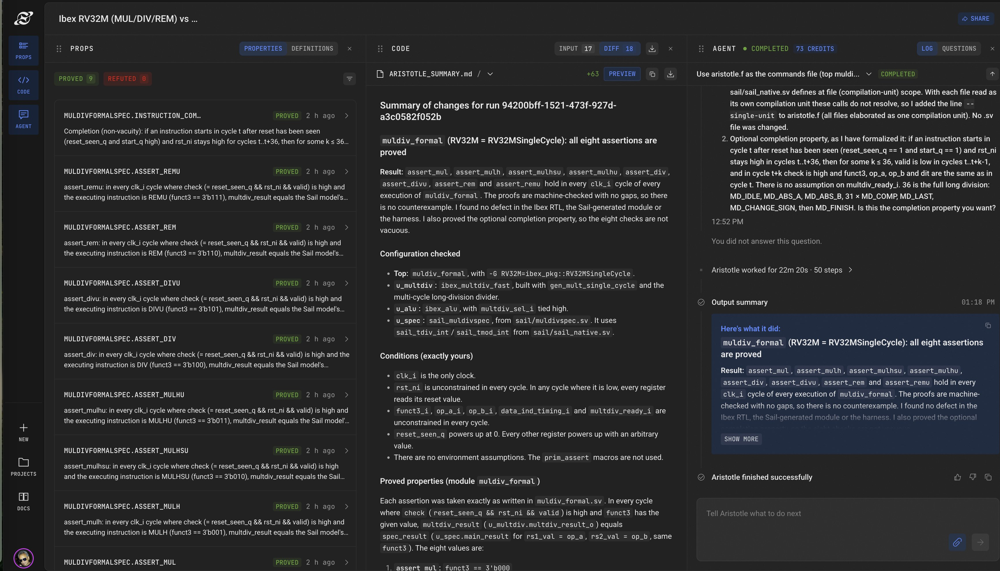
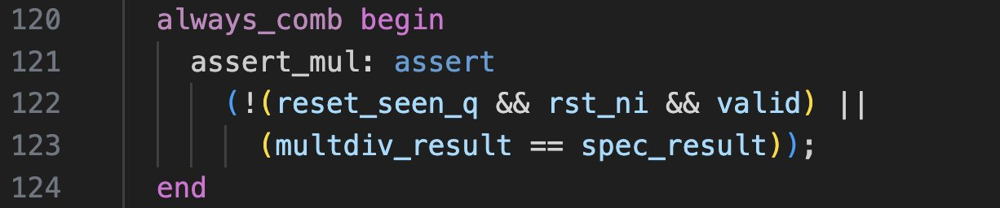
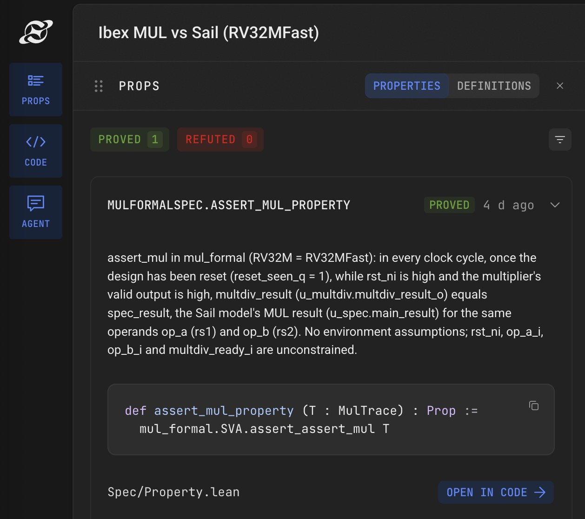

# Formally Verifying the MUL and DIV instructions of the Ibex RISC-V CPU using Aristotle

**It takes just one sentence to formally verify the functional correctness of all the multiplication and division instructions of the Ibex RISC-V CPU** using our Aristotle AI theorem prover via MCP: "*Use Aristotle to formally verify the multiplication and division instructions for the Ibex RISC-V core configured with a single-cycle multiplier by comparing the RTL implementation against the SAIL RISC-V SVA formal specification.*" **That's it!**

This will orchestrate the formal verification of the MUL and DIV instructions against the formal specification provided by the SAIL ISA specification for RISC-V, with Aristotle reporting each property as being proved correct e.g.

*Aristotle indicates a status of PROVED for the property that checks if the Ibex RTL implementation of the MUL instruction for the single-cycle multiplier matches the behavior expected by the SAIL ISA formal specification.*

All you need to do is to install Aristotle and register its MCP server with your favorite agent (Claude, Codex etc.). <https://aristotle.harmonic.fun/>

Then checkout the lowRISC Ibex RISC-V core for GitHub: <https://github.com/lowrisc/ibex>

Then cd into the ibex directory and use your agent with the prompt the one line prompt. That's it!

*Just provide the one line prompt to your favorite agent, after you have installed Aristotle and set up MCP access.*

This will automatically download other artifacts that are required e.g. the SAIL RISC-V SVA model <https://github.com/riscv/sail-riscv> and create a harness for orchestrating the formal verification. We use the formal model of the RISC-V CPUs ISA developed by RISC-V International, using the Sail tools from the Universities of Cambridge and Edinburgh: <https://github.com/rems-project/sail>

After your agent creates the verification setup it submits it to Aristotle for formal verification. The progress of the formal verification can be tracked at <https://aristotle.harmonic.fun/projects>

*When your agent has created the verification setup and submitted the verification job to Aristotle, you can see it on the dashboard <https://aristotle.harmonic.fun>*

Aristotle **compiles** the source SystemVerilog code and any SystemVerilog Assertions into Lean 4 code against a carefully handcrafted formal model of digital circuits. Our approach does not rely on a non-deterministic and unsound transliteration of SystemVerilog into Lean with an LLM.

Aristotle formally verifies 9 properties about the instructions MUL, MULH, DIV, REV etc. You can see the full verification report at this URL (you'll need to sign in first): <https://aristotle.harmonic.fun/projects/80e89bbc-2d03-46c5-86fa-f60c186de8aa>

*When complete the verification dashboard indicates the proof status of each property.*

What's being proved: eight assertions (`assert_mul` … `assert_remu`). Each says that whenever Ibex's `ibex_multdiv_fast` (with `RV32M = RV32MSingleCycle`) reports a valid result for that instruction, the result equals what the Sail model writes to `rd` for the same operands. The prompt asks it to cover division by zero, signed overflow (`0x80000000 / -1`) and both values of `data_ind_timing`. It also asks for a proof that every instruction completes, so the checks can't pass vacuously. There are no environment assumptions.

This is the top-level SVA property that is proved for the MUL instruction, which connects the MUL RTL implementation to the formal specification taken from the SAIL RISC-V ISA model.

*An SVA property that connects the MUL RTL operation to the SAIL ISA specification for MUL.*

This is the Lean representation of the SVA property that checks the functional correctness of the MUL instruction.

*The Lean representation of the MUL correctness property.*

In the Ibex repo there are formal verification script for formally verifying many SAIL ISA properties but the formal check for the correctness of the MUL instruction is omitted because it can't be done with model checking based tools. However, as you see, Aristotle has no problems proving correct the MUL and related instructions.

Verifications for the multi-cycle versions of the MUL etc. instructions are also formally verified by Aristotle without problems.

*A similar formal verification that was performed for the fast multi-cycle version of the MUL instruction.*

Now you have seen how easy it to apply the Aristotle theorem prover, try out this verification for yourself, or run it on your own SystemVerilog code. Provide SVA, ask Aristotle to automformalise properties you specify in English, or even ask Aristotle to come up with relevant properties itself and then prove them. Try it out! <https://aristotle.harmonic.fun/>

*This post was originally published on [X](https://x.com/satnam6502/status/2117656802523312311) and [LinkedIn](https://www.linkedin.com/pulse/formally-verifying-mul-div-instructions-ibex-risc-v-cpu-satnam-singh-qduvc).*
