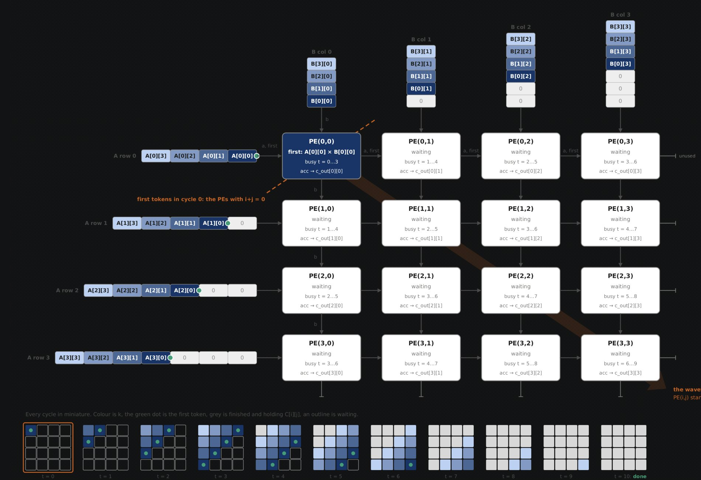
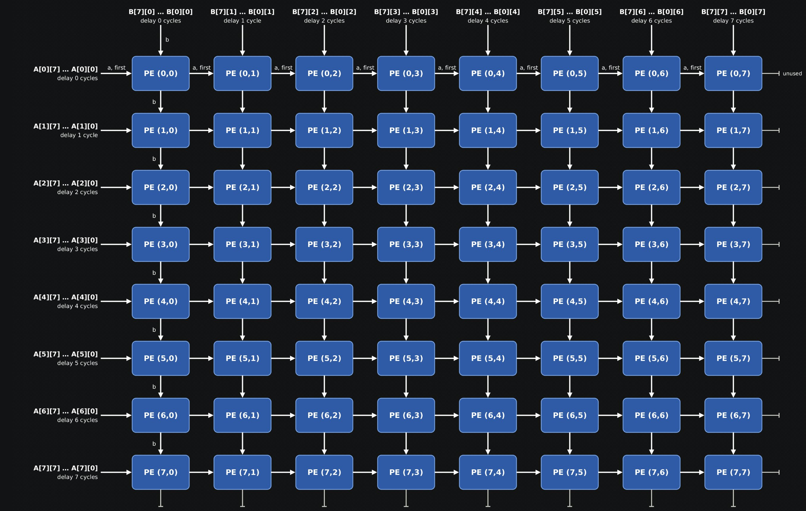
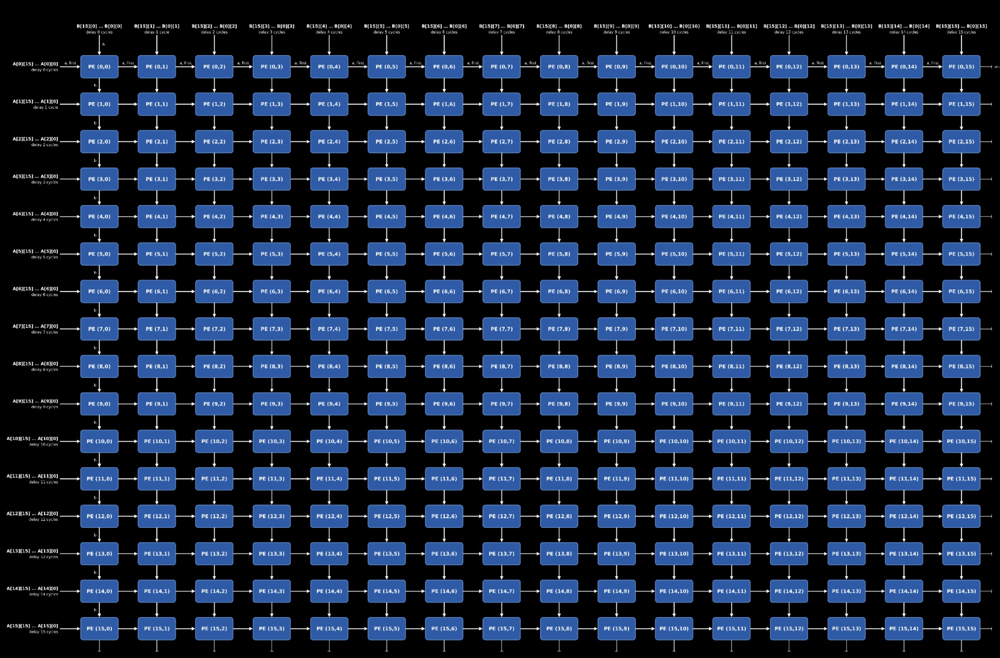
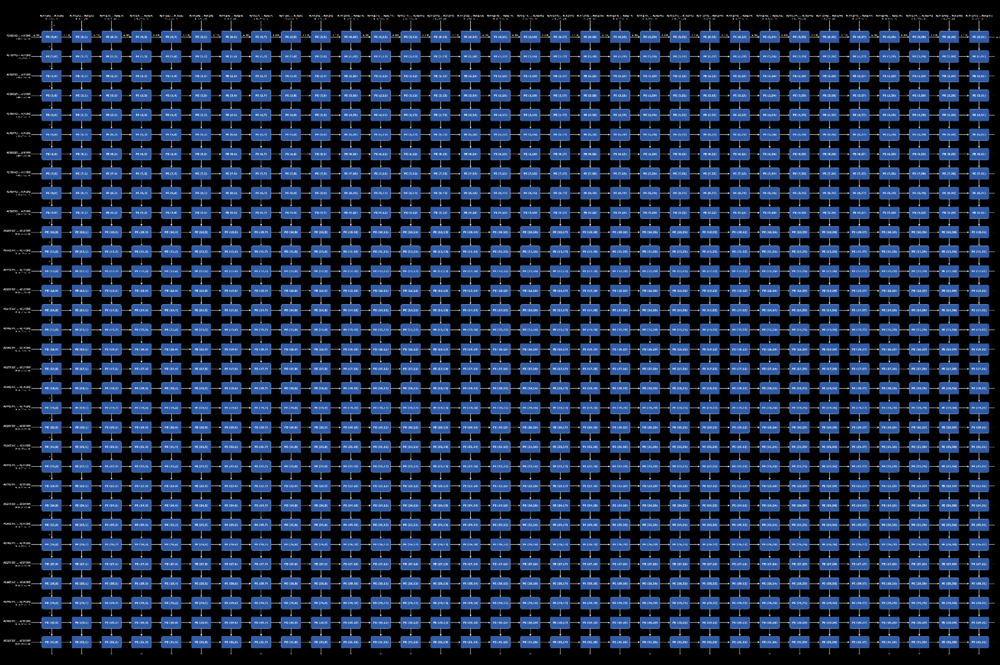
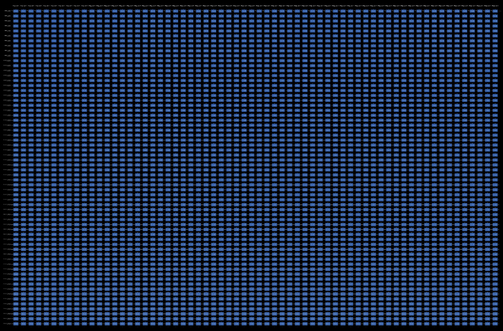
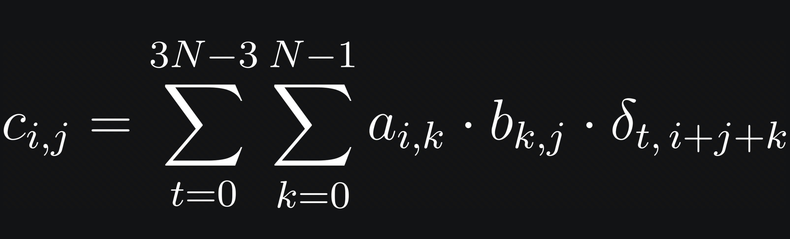

# Formally verifying systolic array matrix multipliers with Aristotle

This thread contains links to Aristotle formal verification reports for a systolic array matrix multiplier at sizes 4x4, 8x8, 16x16, 32x32 and 64x64 for FP16 values. You can read the properties that were formally verified in Lean 4, see the SystemVerliog code, and read the verification summary. The formal verification is a direct comparison against a high level functional specification of a pipelined systolic matrix multiplier. I think this kind of direct formal verification of a matrix like this against a fairly direct high level specification is unusual.

## 4x4

<https://aristotle.harmonic.fun/projects/be0e5f8b-8206-4667-8773-3e8fd849fc7d>

## 8x8

<https://aristotle.harmonic.fun/projects/0a8ebdf7-e12e-4630-9005-235ce50b7b6b>

## 16x16

<https://aristotle.harmonic.fun/projects/3a4c7300-3caa-464d-9e90-3dce986e4f44>

## 32x32

<https://aristotle.harmonic.fun/projects/6f9facb7-678a-409e-98d3-d822c6c743ee>

## 64x64

<https://aristotle.harmonic.fun/projects/45d1b990-d499-484b-b456-e9a4113affda>

*Tap or click an image to open it at full resolution.*

## How the multipliers were produced and specified

The systolic array matrix multipliers were AI generated, along with tests. The process to produce them also involved mutation tests to break the implementation and make sure the correctness theorem no longer prover (to ensure the theorem connected the specification to the implementation).

The SystemVerilog specification is a fairly direct transcription of this, which captures the same/time pipelined behavior of the systolic array matrix multiplier (for the N=4 case):

*This post was originally published as a [thread on X](https://x.com/satnam6502/status/2118782072319795303).*
